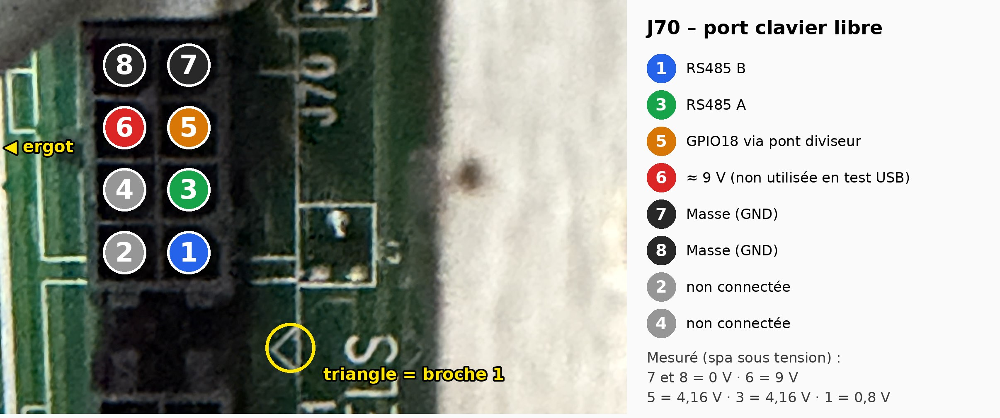
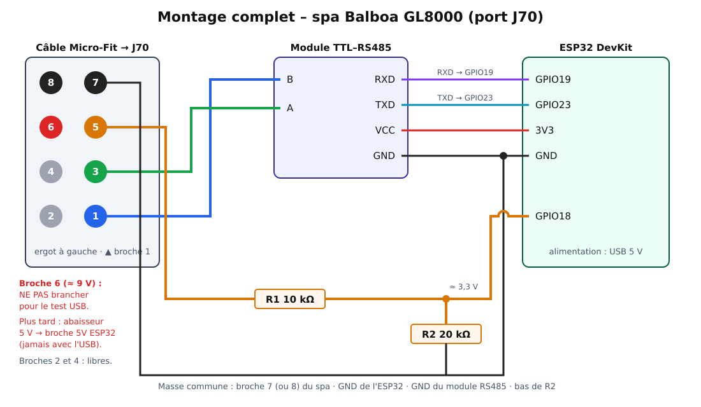

# Spa Balboa GL/EL – pilotage depuis le téléphone (version française)

Firmware ESP32 qui se branche sur la carte de commande d'un spa Balboa des séries GL/EL (GL2000, GL2001, GL8000, EL2000, EL8000…) par un port clavier principal libre, et qui fournit une page web pour piloter le spa depuis un téléphone, sans Home Assistant.

Ce dépôt est une **traduction française** du projet [zaiclopz/jacuzzi-balboa](https://github.com/zaiclopz/jacuzzi-balboa) (interface d'origine en roumain), lui-même basé sur [netmindz/balboa_GL_ML_spa_control](https://github.com/netmindz/balboa_GL_ML_spa_control) (décodage du protocole, communication RS485).

Changements par rapport à l'original :

- interface, journal, messages d'erreur et portail Wi-Fi traduits en français ;
- tuiles renommées selon l'équipement réel : **Pompe 1**, **Pompe 2**, **Blower**, **Éclairage** ;
- mises à jour en ligne tirées de **ce** dépôt (sinon une mise à jour réinstallerait la version roumaine).

## Ce que fait le module

- Page web pour téléphone : température de l'eau, consigne (+/−), chauffe, pompes 1 et 2, blower, éclairage, mode Standard / Économie / Veille.
- Température extérieure et météo pour la ville indiquée dans la page. C'est le téléphone qui la récupère auprès du service gratuit [Open-Meteo](https://open-meteo.com) (usage non commercial) : elle n'apparaît que si le téléphone a Internet.
- Codes d'erreur (facultatif, case « Codes d'erreur » dans Personnalisation, désactivée par défaut) : quand l'afficheur du spa montre un code (OHH, dr, SnA, LF…), il apparaît sous le graphique avec son explication. Les codes inconnus apparaissent tels quels. Le format exact des messages d'erreur sur le bus n'est pas confirmé sur toutes les cartes.
- Graphique de la température de l'eau sur 24 h (un point toutes les 5 minutes, perdu au redémarrage du module).
- Personnalisation depuis la page : nom affiché, ville pour la météo, nom et affichage de chaque fonction. Les réglages sont enregistrés dans le module et valent pour tous les téléphones.
- Icône sur l'écran du téléphone (Chrome : ⋮ → « Ajouter à l'écran d'accueil » ; Safari : Partager → « Sur l'écran d'accueil »).
- Mise à jour en temps réel (WebSocket), sans recharger la page.
- Configuration Wi-Fi depuis le téléphone, sans mot de passe dans le code.
- Home Assistant par MQTT, en option.
- Mise à jour du firmware par Wi-Fi.

## Matériel

| Article | Remarque |
|---|---|
| ESP32 DevKit (ESP-WROOM-32), USB-C | 30 ou 38 broches, les deux conviennent |
| Module TTL–RS485 à contrôle **automatique** de direction | broches TXD, RXD, VCC, GND, **sans** RE/DE |
| Câble Molex **Micro-Fit 3.0**, 8 broches (prise 43025-0800), fils nus | pas de 3 mm, vérifié sur la prise du ML700 |
| 2 résistances : **10 kΩ** et **20 kΩ** (ou 3 × 10 kΩ) | pont diviseur de la broche 5 |
| Chargeur USB 5 V + câble USB-C | alimentation pour le test |
| Câbles Dupont, gaine thermorétractable, boîtier IP65, presse-étoupe PG7 | montage final |
| *Facultatif :* abaisseur 5 V à sortie USB, entrée dès 6 V | pour alimenter l'ESP32 par le spa (broche 6), voir « Alimentation » |

## Branchements (spa Balboa GL8000M3, port J70)

Les ports clavier « MAIN PANELS » sont **J70 à J73**. Sur ce spa, le clavier ML700 est sur **J72** ; le module se branche sur **J70**, qui est libre. Ne pas utiliser les ports « AUX. PANELS » (6 broches), ni de câble en Y.

### Repérage des broches de J70

Sur la carte, la prise est verticale, avec **l'ergot à gauche**. Un **petit triangle** imprimé sous la prise, côté droit, repère la **broche 1**. C'est l'inverse de la photo du projet d'origine, où la prise est tournée d'un demi-tour.



| Broche (position sur la photo) | Rôle | Relié à | Mesuré (spa sous tension) |
|---|---|---|---|
| **1** (bas, droite) | RS485 B | module RS485 **B** | 0,8 V ✅ |
| **3** (3ᵉ rang, droite) | RS485 A | module RS485 **A** | 4,16 V ✅ (A > B : bus au repos, polarité confirmée) |
| **5** (2ᵉ rang, droite) | sélection clavier (signal 5 V) | **GPIO18 par le pont diviseur** | 4,16 V ✅ (moyenne d'un signal 5 V) |
| **6** (2ᵉ rang, gauche) | ≈ 9 V | rien pour le test (plus tard : abaisseur 5 V) | 9 V ✅ |
| **7** (haut, droite) | masse | GND commun | 0 V ✅ |
| **8** (haut, gauche) | masse | (inutile si la 7 est branchée) | 0 V ✅ |
| 2 et 4 | — | non connectées | — |

### Schéma complet



| Module RS485 | ESP32 |
|---|---|
| RXD | GPIO19 |
| TXD | GPIO23 |
| VCC | 3V3 |
| GND | GND |

### Pont diviseur de la broche 5 (obligatoire)

La broche 5 est un signal en **5 V** (mesuré : ≈ 5 V). L'ESP32 accepte **3,6 V au maximum** sur ses entrées. Le projet d'origine la relie directement au GPIO18 ; ici, on protège l'ESP32 :

```
Broche 5 du spa ──[ R1 10 kΩ ]──┬── GPIO18 (ESP32)
                                │
                           [ R2 20 kΩ ]   (ou 2 × 10 kΩ en série)
                                │
Broche 7 (masse) ───────────────┴── GND (ESP32)
```

Le GPIO18 reçoit ≈ 3,3 V à l'état haut. **Mesurez vos résistances** avant de souder (les résistances bleues à 5 anneaux du tiroir font peut-être 100 Ω : elles ne conviennent pas).

### Alimentation

Deux solutions possibles. On commence **toujours** par la première.

**Solution 1 : chargeur USB (pour le test, et en définitif si une prise est disponible)**
- Un chargeur USB 5 V et un câble USB-C branché sur l'ESP32.
- La broche 6 du spa n'est **pas** branchée.

**Solution 2 : alimentation par le spa (broche 6, ≈ 9 V)**

Un petit module abaisseur transforme les 9 V de la broche 6 en 5 V, sur une **sortie USB** : on y branche directement le câble USB-C de l'ESP32, sans souder sur la broche 5V.

| Module | Prix | Remarque |
|---|---|---|
| [JZK 12/24 V → 5 V 5 A, sortie USB (Amazon.co.uk)](https://www.amazon.co.uk/dp/B071ZRXKJY) | ≈ 14,60 € | celui que recommande le projet netmindz ; **non livrable en France** (vérifié le 22/11/2026) |
| [Lot de 2 abaisseurs 6–24 V → 5 V USB 3 A (Amazon.fr)](https://www.amazon.fr/dp/B07JLTTZXL) | ≈ 5,13 € les 2 | **équivalent conseillé** : entrée dès 6 V, bonne marge avec les 9 V de la broche 6 |

Branchement : broche **6** du spa → entrée **+** du module, broche **7** (ou 8) → entrée **−**, puis câble USB du module → ESP32.

- **À éviter :** les modules annoncés « 9 V–24 V → 5 V ». Avec 9 V mesurés sur la broche 6, ils sont à la limite et risquent de ne pas donner 5 V stables.
- **Ne jamais brancher le chargeur USB et le module en même temps.**
- La broche 6 a un **courant limité**. L'ESP32 tire environ 100 à 150 mA côté 9 V lors des pointes Wi-Fi, ce que le projet netmindz utilise sans problème. Si le module redémarre tout seul, revenir à la solution 1.

## Quand tout est reçu : déroulé du montage

1. **Préparer le câble Micro-Fit :** repérer au multimètre (continuité) quel fil arrive sur les broches 1, 3, 5, 6 et 7 de la prise. Les couleurs des fils ne veulent rien dire. Isoler les fils 2, 4, 6 et 8.
2. **Souder le pont diviseur** (R1, R2) et le vérifier au multimètre.
3. **Câbler** l'ESP32 et le module RS485 selon le schéma, avec une masse commune.
4. **Installer le firmware** sur l'ESP32 depuis l'ordinateur (voir plus bas), **avant** de le brancher au spa.
5. **Couper le spa au tableau**, brancher la prise sur **J70**, ergot à gauche comme celle du ML700 sur J72.
6. Remettre le spa sous tension. Avant de brancher l'ESP32, **mesurer le point milieu du pont diviseur** : ≈ 3,2 à 3,3 V maximum.
7. Brancher l'ESP32 sur le **chargeur USB**, se connecter au Wi-Fi « Jacuzzi-Setup », puis ouvrir **http://jacuzzi.local**.
8. **Test en lecture seule :** la température et le mode affichés doivent correspondre au ML700.
   - Aucune donnée : **inverser les fils A et B**.
   - « Broche 5 non détectée » : vérifier le fil de la broche 5 et le pont diviseur.
9. **Capturer les touches** du ML700 (voir ci-dessous), puis tester un changement de mode Économie → Standard depuis la page.
10. Installation définitive dans le boîtier IP65, câble passé par un presse-étoupe.

⚠️ **Coupez l'alimentation du spa au tableau avant tout branchement ou débranchement.** Les mesures sous tension se font uniquement dans la zone des connecteurs basse tension, à droite de la carte, loin des borniers et des relais.

## Installer le firmware

### Méthode simple (depuis le navigateur)

> **Depuis la version 1.8.1, la mémoire flash est organisée autrement** (1,9 Mo pour le programme). La première installation doit être faite par USB avec `jacuzzi-full-install.bin`. Une mise à jour par Wi-Fi depuis une version plus ancienne garderait l'ancienne organisation.

1. Ouvrez [Releases](../../releases) et téléchargez `jacuzzi-full-install.bin` (installation complète). `jacuzzi-update.bin` sert aux mises à jour par Wi-Fi. Sans version publiée, prenez l'artefact `jacuzzi-firmware` du dernier build réussi dans [Actions](../../actions) (conservé 90 jours).
2. Branchez l'ESP32 à l'ordinateur en USB et ouvrez dans Chrome ou Edge : https://espressif.github.io/esptool-js/
3. Cliquez sur **Connect** et choisissez le port de l'ESP32.
4. Dans **Flash Address**, saisissez `0x0`, choisissez `jacuzzi-full-install.bin`, puis cliquez sur **Program**.

### Méthode pour développer (PlatformIO)

```
cd sensor
pio run -e esp32dev -t upload
pio device monitor
```

La page web se modifie dans `sensor/web/index.html`. Le fichier `sensor/src/webui.h` est régénéré automatiquement à chaque compilation. Les icônes se refont avec `python sensor/web/make_icons.py` (nécessite Pillow).

## Premier démarrage

1. Alimentez l'ESP32. Sur le téléphone, le réseau Wi-Fi **Jacuzzi-Setup** apparaît : connectez-vous-y.
2. La page de configuration s'ouvre (sinon, allez sur `http://192.168.4.1`). Choisissez votre réseau et saisissez son mot de passe. Laissez les champs MQTT vides si vous n'utilisez pas Home Assistant.
3. L'ESP32 redémarre et rejoint votre réseau.
4. Page du spa : **http://jacuzzi.local** (ou l'adresse IP de l'ESP32 indiquée par la box).

Si le réseau enregistré est indisponible au démarrage, le point d'accès Jacuzzi-Setup reste ouvert 5 minutes, puis l'ESP32 redémarre et réessaie.

## Utilisation

- **Consigne :** appuyez sur + ou − ; la valeur est envoyée après 1,5 s sans appui. Si la consigne est « Inconnue », un appui la lit dans le spa.
- **Pompes, blower, éclairage :** chaque appui équivaut à la touche correspondante du clavier.
- **Mode :** Standard / Économie / Veille. Pour un spa peu utilisé : laissez-le en Économie et passez en Standard la veille du bain.
- **Réglages et informations** (en bas de page) : personnalisation, version du firmware, mise à jour, changement de réseau Wi-Fi.

## Vérifier les codes de votre clavier (premier test)

Les codes des touches viennent de claviers de GL2000. Avant de compter dessus :

1. Ouvrez **Journal (dépannage)** et cochez **Capturer les touches du clavier du spa**.
2. Appuyez sur une touche du clavier du spa (ML700…), puis notez-la avec **Ajouter la note**.
3. Le code apparaît avec la lettre **P**. Comparez-le à ceux de `sensor/src/constants.h`. Un bouton **Envoyer** permet de le rejouer pour tester.

## Programmation des modes de chauffe

Section **Programmation** de la page. Le module change le mode (Standard / Économie / Veille) à l'heure dite, en simulant les touches du clavier :

- **Chaque semaine** : jours, heure, mode (8 horaires au maximum). Exemple : Standard le vendredi à 18:00, Économie le dimanche à 20:00.
- **Une seule fois** : date, heure, mode (6 dates au maximum), supprimée une fois exécutée.
- Le **prochain changement** s'affiche sous le mode de chauffe, sur la page d'accueil.
- Le module prend l'heure sur Internet (heure de France, passage été/hiver automatique). Sans Internet, il attend que l'heure soit connue (elle est aussi donnée par le téléphone à l'ouverture de la page).
- Si le changement est impossible sur le moment (mode inconnu, commandes en cours), le module réessaie pendant 15 minutes.
- La section affiche aussi l'**heure du spa** et l'écart avec l'heure réelle.
- **Pas encore possible :** régler l'heure du spa et les **cycles de filtration** depuis la page. Il faut d'abord relever avec l'espion la navigation dans les menus du ML700 (touches Time et Mode/Prog).

## Codes des touches et pompe 3

**Réglages et informations → Codes des touches (avancé)** : code envoyé au spa pour chaque touche. Après une capture (Journal → « Capturer les touches du clavier du spa »), collez le code affiché avec la lettre **P**, puis **Enregistrer** ; **Tester** l'envoie une fois au spa. Un champ vide remet le code par défaut.

La tuile **Pompe 3** apparaît dès que le code de **Jets 3** est renseigné (il n'a pas de valeur par défaut).

## Espion du bus (analyse des trames)

Section **Espion du bus (trames)** en bas de la page.

| Mode | Ce qui est enregistré |
|---|---|
| **Simple** | une trame seulement si elle diffère de la précédente du même type : idéal pour voir ce qui change |
| **Avancé** | toutes les trames (FA, AE, FB), de tous les ports |

- Le module garde les dernières trames dans un **tampon tournant en mémoire vive** (environ 1 500 trames, rien n'est écrit en mémoire flash). Quand il est plein, les plus anciennes sont écrasées.
- **C'est le téléphone qui accumule tout l'historique**, tant que la section est ouverte. Gardez l'écran allumé ; si le téléphone se met en veille, les trames manquées sont signalées « perdues ».
- Le compteur **trames/s** indique le débit réel du bus : en mode avancé, 10 minutes ≈ 600 × ce nombre de trames (≈ 70 octets chacune dans le fichier).
- **Ajouter un repère** : note horodatée dans l'historique (« démarrage pompe 3 »…), pour retrouver le moment d'une action.
- **Enregistrer sur le téléphone** : fichier texte `espion-spa-AAAAMMJJ-HHMMSS.txt`, à envoyer pour analyse. Colonnes : n°, heure, ms du module, **N** (notre tour, J70) ou **A** (autre port), type, trame en hexadécimal.
- Les octets **surlignés** sont ceux qui ont changé depuis la trame précédente du même type.

**Méthode pour identifier un équipement** (pompe 3, blower, ozone) : mode simple, repère « avant », démarrer l'équipement, repère « marche », l'arrêter, repère « arrêt », puis enregistrer le fichier.

Limite : en dehors de notre tour, le module ne sait pas à quel port une trame est destinée (seule la broche 5 de J70 lui est reliée).

## Mise à jour du firmware par Wi-Fi

**En ligne :** **Réglages et informations → Rechercher une mise à jour → Installer**. Le module télécharge la dernière version publiée dans les [Releases de ce dépôt](https://github.com/fquillerier/jacuzzi-balboa/releases), vérifie le fichier (SHA-256) et redémarre. Le téléphone doit avoir Internet. Historique des versions : [CHANGELOG.md](CHANGELOG.md).

**Manuelle :** **Réglages et informations → Mise à jour manuelle (fichier)** (ou `http://jacuzzi.local:8080/update`), puis envoyez `jacuzzi-update.bin`.

## Sécurité

Le module n'a **aucun mot de passe** (page, API, mise à jour manuelle sur le port 8080, telnet sur le port 23). N'importe quel appareil de votre réseau local peut donc le piloter ou y installer un autre firmware.

- N'ouvrez **jamais** de port vers le module sur votre box.
- Pour un accès hors de chez vous, passez par le **VPN de votre box** (WireGuard…).
- Idéalement, placez le module sur un réseau invité ou dédié aux objets connectés.

## API (pour les intégrations)

| Adresse | Rôle |
|---|---|
| `GET /api/status` | État en JSON |
| `GET /api/cmd?a=up\|down\|light\|jet1\|jet2\|aux\|mode\|time` | Un appui de touche |
| `GET /api/target?t=37.5` | Réglage de la consigne (26–40 °C, pas de 0,5) |
| `GET /api/mode?m=0\|1\|2` | Standard / Économie / Veille |
| `GET /api/config` / `POST /api/config` | Réglages de la page (nom, fonctions affichées) |
| `GET /api/history` | Température des dernières 24 h |
| `POST /api/wifireset` | Efface le réseau Wi-Fi et redémarre en mode configuration |
| WebSocket port 81 | État en temps réel |

## Limites connues

- Les commandes sont des appuis de touches simulés. L'état affiché est celui que renvoie la carte du spa : il change après confirmation par la carte.
- Les codes des pompes viennent du projet d'origine et y sont signalés comme non vérifiés sur tous les modèles.
- La **pompe 3** n'est pas gérée : son code de touche et son état ne sont pas connus (voir ci-dessous).
- L'état du blower n'est pas lu dans les messages de la carte : la tuile ne fait que basculer.
- La consigne n'est connue qu'après un passage de la carte dans le menu de réglage de la température.

## Équipements non gérés (pompe 3, ozone, filtration)

Le message d'état décodé ne contient que : température, pompes 1 et 2 (2 bits chacune), chauffe, éclairage, mode, heure et texte de l'afficheur. Pour ajouter un équipement, il faut :

1. **Son code de touche** : à capturer avec la fonction « Capturer les touches » ci-dessus (pour la pompe 3 : touche Jets 3 du clavier).
2. **Son état** : repérer quel octet du message change quand il démarre. Le journal affiche les messages bruts (lettre **R**) : notez l'heure, démarrez l'équipement, comparez.

L'ozonateur et les cycles de filtration ne se commandent pas depuis le clavier : ils sont gérés par la carte. Seul leur état pourrait être affiché, une fois l'octet correspondant identifié.
